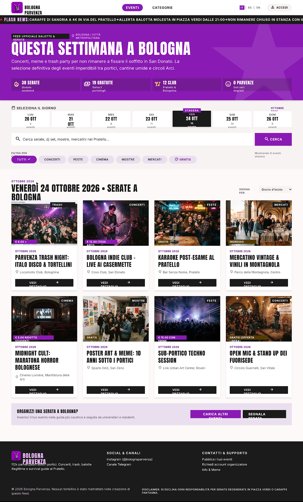
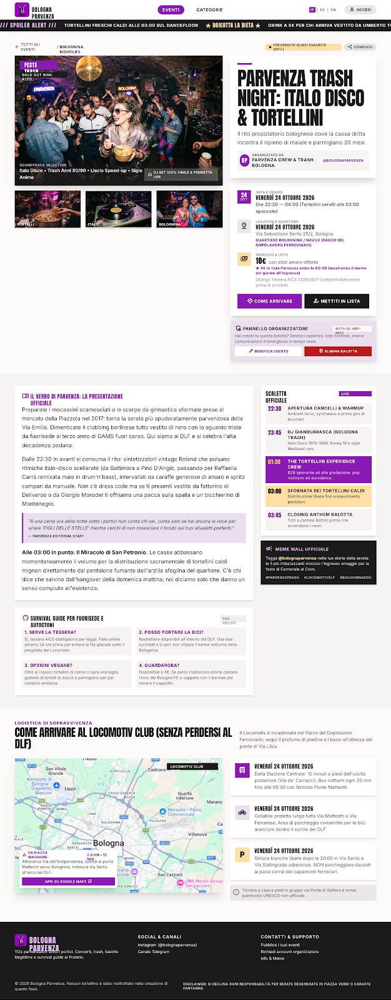
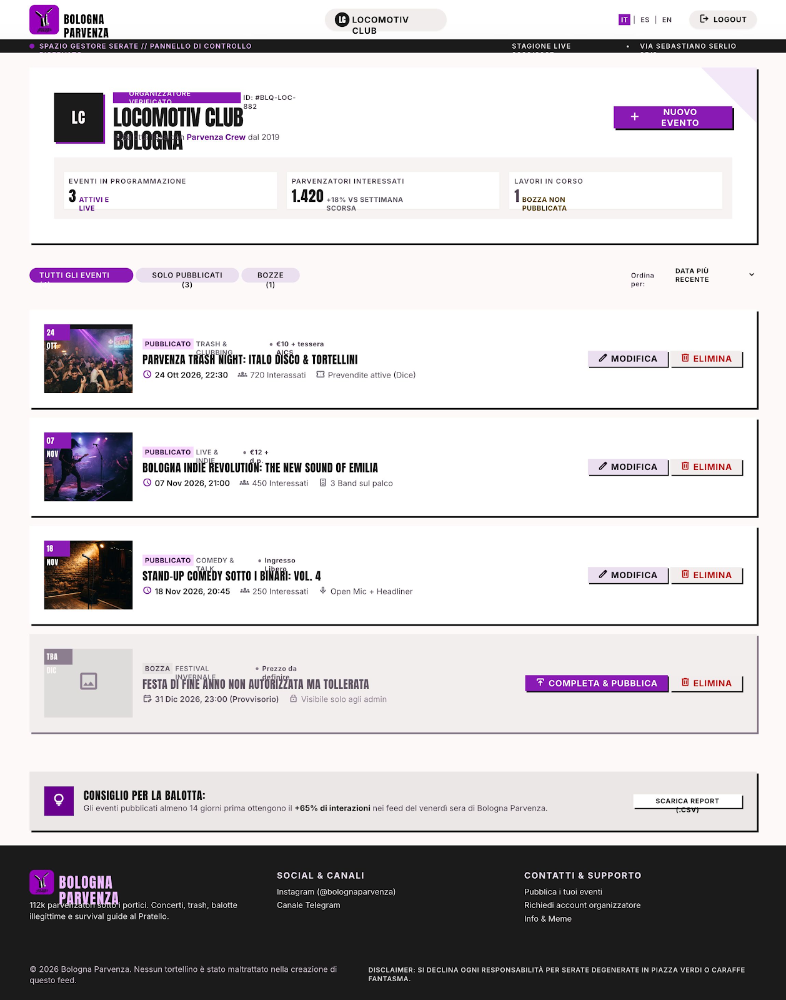
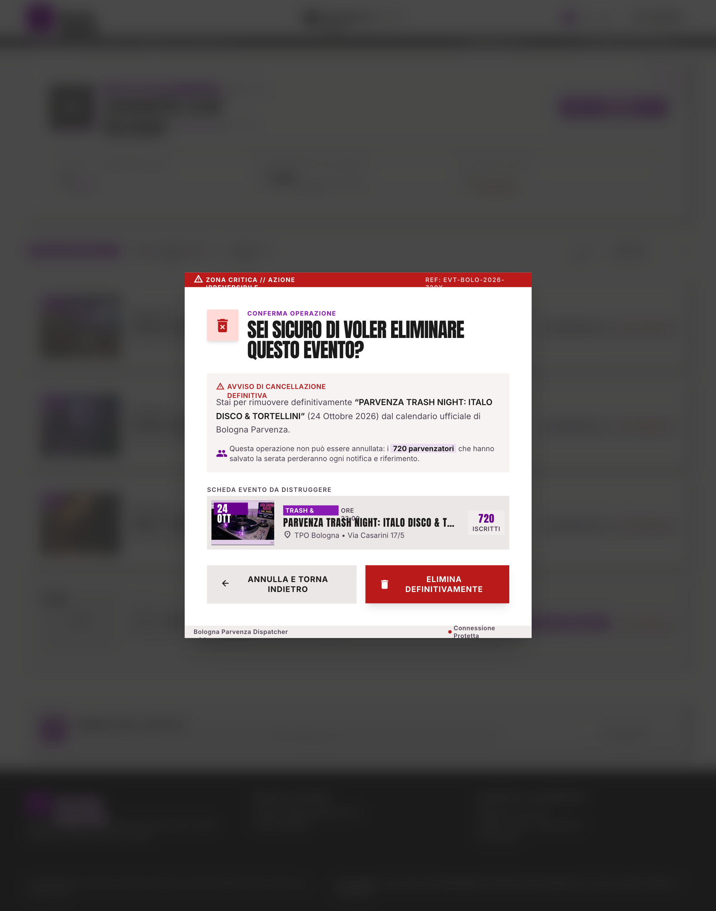

# Bologna Parvenza – Agenda semanal de eventos

Proyecto fullstack del Máster de Diseño y Desarrollo Web (CEI) · Gemma Centrone

Agenda web con los eventos de Bologna semana a semana, creada a partir de la comunidad de Instagram [@bologna_parvenza](https://www.instagram.com/bologna_parvenza/). El público consulta y filtra los eventos sin registrarse; los organizadores con suscripción acceden con login para crear, editar y eliminar sus propios eventos.

**Stack:** React · Node.js · Express · MongoDB Atlas · Vercel

## Estructura del repositorio

| Carpeta | Contenido |
| --- | --- |
| `docs/` | Documentación: idea del proyecto y análisis de referencias |
| `design/` | Diseño de la interfaz (Google Stitch) |
| `data/` | Propuesta de base de datos en JSON |

## PEC 1 – Investigación, diseño y arquitectura de datos

- **Idea y referencias:** [docs/pec1-idea-referencias.pdf](docs/pec1-idea-referencias.pdf)
- **Diseño en Google Stitch:** [ver proyecto en Stitch](https://stitch.withgoogle.com/projects/13932656277757693528) (requiere iniciar sesión con una cuenta de Google)
- **Código exportado de Stitch:** [design/DESKTOP](design/DESKTOP) · [design/MOBILE](design/MOBILE) (HTML y captura de cada pantalla)
- **Base de datos:** [data/users.json](data/users.json) · [data/events.json](data/events.json). Propuesta generada con ayuda de IA (Claude) y revisada manualmente.

### Capturas

| Home | Detalle |
| --- | --- |
|  |  |
| **Área del organizador** | **Eliminar evento** |
|  |  |

## Diseño en Google Stitch

| Pantalla | Descripción | CRUD |
| --- | --- | --- |
| **Home** | Página principal pública. Hero con el título "Questa settimana a Bologna", selector de días de la semana, buscador y filtros por categoría. Debajo, listado de eventos en tarjetas con imagen, categoría, precio, fecha, lugar y botón "Vedi dettaglio". | Listar |
| **Dettaglio** | Ficha completa de un evento: imagen principal, galería, título, organizador, fecha y horario, local y barrio, precio y condiciones de entrada, descripción, programa de la noche, preguntas frecuentes y mapa para llegar. Si el usuario es el organizador del evento, aparece un panel con los botones "Modifica" y "Elimina". | Ver |
| **Categorie** | Índice de las seis categorías (Conciertos, Fiestas, Cine, Exposiciones, Mercados, Otros) en tarjetas con imagen y número de eventos de la semana. Al pulsar una categoría se vuelve al listado filtrado. | Listar (filtrado) |
| **Login** | Acceso para organizadores con email y contraseña. No hay registro público: las cuentas las da de alta la administradora, y la pantalla explica cómo solicitar una. | — |
| **Schermata organizzatore** | Área privada del organizador: datos del local, estadísticas básicas, botón "Nuovo evento" y lista de sus eventos (publicados y borradores) con los botones "Modifica" y "Elimina" en cada uno. | Listar (privado) |
| **Crea evento** | Formulario de creación dividido en bloques: datos básicos (título, descripción, categoría), fecha y horario de inicio y fin, local, dirección y barrio, precio o casilla "Gratis" e imagen del cartel. Botones "Annulla" y "Pubblica evento". | Añadir |
| **Modifica evento** | El mismo formulario que "Crea evento", con los datos del evento precargados, vista previa del cartel y botones "Aggiorna evento" y "Annulla". | Editar |
| **Elimina evento** | Diálogo de confirmación sobre el área del organizador: aviso de que la acción es irreversible, resumen del evento y botones "Annulla e torna indietro" y "Elimina definitivamente". | Eliminar |
| **Organizzatore – Evento aggiunto** | Área del organizador después de publicar un evento: aviso verde "Evento aggiunto con successo" y el nuevo evento al principio de la lista (simulación del resultado de "Añadir"). | Añadir (resultado) |
| **Organizzatore – Evento eliminato** | Área del organizador después de eliminar un evento: aviso verde "Evento eliminato con successo" y un evento menos en la lista (simulación del resultado de "Eliminar"). | Eliminar (resultado) |
| **404** | Página de error con el tono irónico de la marca ("Ti sei perso sotto i portici?") y botones para volver a los eventos o a las categorías. | — |

Todas las pantallas comparten el mismo header (logo, menú "Eventi" / "Categorie", selector de idioma IT · ES · EN y botón "Accedi") y el mismo footer. Las pantallas del organizador sustituyen "Accedi" por el nombre del local y "Logout".

**Versión móvil:** las pantallas principales tienen también una versión móvil (390 px) con menú hamburguesa, tarjetas en una sola columna y formularios a una columna. Es una propuesta inicial del diseño responsive, que se desarrollará en la PEC 4.
